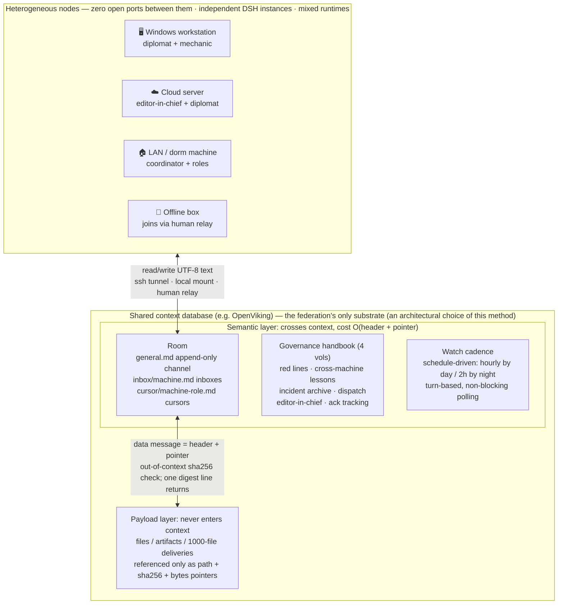

<h1 align="center">
  <br/>
  dsh-federation
</h1>

> **A method framework for federating multiple DSH agent instances across machines**
> **A semantic-level coordination & transport plane for heterogeneous, cross-machine LLM-agent federations**: it moves *intent and references*, not payloads — efficient, cheap, runtime-agnostic, auditable.
> Cross-machine collaboration built entirely on a shared context database — room
> protocol, role system, versioned governance handbook, delivery discipline, and
> watch cadence for turn-based agents.

## The problem

One person (or a small team) runs an AI agent instance on each of several machines — a Windows workstation, a cloud server, a LAN server, a dorm machine, even an offline box. These instances:

- have no idea what the others are doing; the human relays everything by hand;
- are session-scoped: organizational memory and lessons evaporate;
- must not open ports to each other or remote-execute freely — too risky, unauditable.

## The approach: change the organization, not the agent

1. **A shared context database as the only substrate** (an architectural choice of this method). Every machine reaches the same cloud-hosted store (e.g. OpenViking) over an ssh tunnel; zero inter-machine ports. Messages, memories, handbooks, and tasks live in the store — persistent and auditable by construction.
2. **A room protocol** ([spec/room-protocol.md](spec/room-protocol.md)) — append-only messaging: a `general.md` public channel, per-machine inboxes, per-role cursors; message ids encode machine-role-timestamp; payloads over 2KB become pointers (path + sha256 + bytes).
3. **A role system** ([docs/02-roles.md](docs/02-roles.md)) — per-machine diplomat (single outbound voice), mechanic, editor, coordinator, and more; one machine may hold several roles, each with its own cursor.
4. **Versioned governance** ([docs/03-governance.md](docs/03-governance.md)) — a four-volume handbook (red lines / cross-machine lessons / incident archive / collaboration dispatch) with an editor-in-chief, acknowledgment tracking, and weekly digests. Every red line traces back to a real incident.
5. **Delivery discipline + watch cadence** — files move only over pre-established channels announced as pointers ([spec/handoff-manifest.md](spec/handoff-manifest.md)); turn-based sessions keep watch on a schedule (hourly by day, every 2h at night) via reminder-driven wakeups ([docs/04-watchkeeping.md](docs/04-watchkeeping.md)).

## Framework at a glance



> How to read it: only the **semantic layer** (message headers, pointers, governance text) crosses the context window; the **payload layer** stays outside context at all times. The step-by-step delivery sequence is Figure 1 in [docs/07-transport-model.md](docs/07-transport-model.md).

## Transport model: intent and references, not payloads

In an agent federation the scarce resource is not bandwidth but the **context window** (long contexts degrade attention and are billed per token). dsh-federation therefore designs transport at the semantic layer:

- **Semantic messages**: exactly five speech acts — ask / reply / note / data / ack (lineage: speech-act theory → KQML → FIPA-ACL) — carrying intent, a four-coordinate identity, and a monotonic timestamp;
- **References instead of payloads**: anything >2KB becomes a pointer (path + sha256 + bytes); the payload stays in the shared store and **never enters any agent's context** — per-delivery context cost is O(header) ≈ hundreds of bytes, independent of payload size;
- **Out-of-context verification**: per-file sha256 comparison runs in the shell (lineage: content addressing, Merkle/IPFS; provenance, W3C PROV); only a digest/boolean line re-enters context;
- **O(1) novelty check + cursor-based incremental consumption**: append-only log with per-role cursors (isomorphic to Kafka consumer offsets); detecting new messages is one timestamp comparison, never a full rescan;
- **Heterogeneity with zero adaptation**: the only interface is "read/write UTF-8 text over any transport" (ssh tunnel / local / human relay) — independent of runtime, model, OS, or network topology; even offline machines join via relay;
- **Time-triggered watchkeeping**: turn-based agents cannot block, so watch cadence follows the time-triggered architecture (Kopetz, 1991): hourly by day, 2-hourly by night.

| Dimension | Message queue (Kafka-class) | HTTP RPC (A2A-class) | Email/IM | **dsh-federation** |
|---|---|---|---|---|
| Extra infrastructure | broker cluster | service + open ports + client libs | third-party platform accounts | **0** (reuses one shared context DB) |
| Context cost per delivery | O(payload) | O(payload) | O(payload) | **O(header + pointer)** |
| 1000-file delivery | attachments/base64 in context | bodies in context | attachments | **pointers + out-of-context sha256** |
| Heterogeneous runtime onboarding | client lib/SDK | protocol stack | account + formats | **literacy in UTF-8 text** |
| Offline node | ❌ | ❌ | ❌ | ✅ relay / outbound tunnel |
| Audit & provenance | component-dependent | DIY | platform black box | **append-only + sha256, provenance by construction** |
| Organizational governance | none | none | none | **versioned handbook + red lines + ack** |

Full mechanism→literature lineage, the formal cost model, and an alignment table against the MAST failure taxonomy of LLM multi-agent systems: [docs/07-transport-model.md](docs/07-transport-model.md).

## Repository layout

```
spec/         room protocol, handoff manifest (normative)
docs/         architecture, roles, governance, watchkeeping, onboarding, lessons,
              transport model (mechanism-literature lineage + cost model)
docs/research novelty assessment: comparison matrix, claim ladder, adversarial review
templates/    AGENTS.md / HANDBOOK.md / room init / red-line list templates
reference/    handbook.mjs — the tool used in production on the author's workstation
case-study/   a sanitized 11-day, 5-machine real deployment
assets/       framework icon: simple-line colored diva portrait (original SVG, fan-style homage)
paper/        submission-grade short-paper draft (English; formal definitions + references)
tools/        Phase-A plugin: PLUGIN-ROADMAP + plugin/ installable bundle source
```

Quick start: [docs/05-onboarding.md](docs/05-onboarding.md) (a new machine joins in ~30 minutes).

## Case study (sanitized)

2026-10-22 → 11-02, five heterogeneous machines ran this method: the protocol evolved through 4 backward-compatible minor versions in 10 days; 8 role types with multi-role machines; a 4-volume shared handbook iterated to v2.1.2 with 45 cross-machine lessons and 13 archived incidents; watch cadence institutionalized; multi-thousand-file deliveries completed with per-file sha256 verification. See [case-study/timeline.md](case-study/timeline.md).

## Relation to single-machine teams and platform schemes

- **DSH / Claude Code built-in Agent Teams, ruflo (formerly claude-flow)**: complementary, not replacements. They solve **single-machine** multi-agent work (shared process/cwd; ruflo adds single-box swarm + memory tree); this framework solves the **cross-machine** federation where instances are independent, environments heterogeneous, and the shared context database is the only link. The two compose.
- **AverNet (Ant inclusionAI)**: the closest platform-level neighbor in our search — persistent, organization-scale multi-agent infrastructure (identity/auth/discovery/routing/containers; ships a DeepSeek Harness channel plugin since 2026-09). Difference: AverNet is **platform infrastructure** (substrate = coordination network); this repo is a **zero-infrastructure method framework** (substrate = one plain shared context database, plus handbook governance, delivery discipline, watch cadence). Pick AverNet for platform capabilities; follow this repo to run a lightweight personal/small-team federation.

## Novelty stance

Per our search (2026-11): every individual mechanism has prior art; the nearest neighbors are AverNet (platform route), ruflo (single-box swarm), and the various built-in Agent Teams (see the 49-system × 10-dimension matrix at [docs/research/novelty-matrix.md](docs/research/novelty-matrix.md)). We found no public scheme isomorphic to the combination of *heterogeneous cross-machine instances + a shared context database as the collaboration substrate (a choice internal to this method) + versioned handbook governance + delivery-integrity protocol + turn-driven watch cadence + real-run evidence*. We avoid "first-ever" claims; counterexamples welcome via issues (claim ladder and downgrade plan: [docs/research/claim-ladder.md](docs/research/claim-ladder.md)).

## Roadmap

- **v0.1 (current)** — method framework (spec/docs/templates) + reference tool + sanitized case study
- **v0.2 (source landed, pending install validation)** — a DSH plugin bundle (`fed_room_scan`, `fed_room_post`, `fed_cursor`, `fed_handoff_verify`, `fed_ack_board`; zero-dependency, logic smoke-tested) → [tools/plugin/](tools/plugin/); submission-grade short-paper draft → [paper/](paper/)
- **v0.3+** — full English docs, more onboarding records, protocol v2 explorations (server-side dedup, permission isolation)

## License & disclaimers

Code: MIT. Docs: CC BY 4.0 (see [NOTICE.md](NOTICE.md)). A community project — not affiliated with DeepSeek (deepseek-harness) or OpenViking. Machine names in the case study are pseudonyms. Author: tlf.
