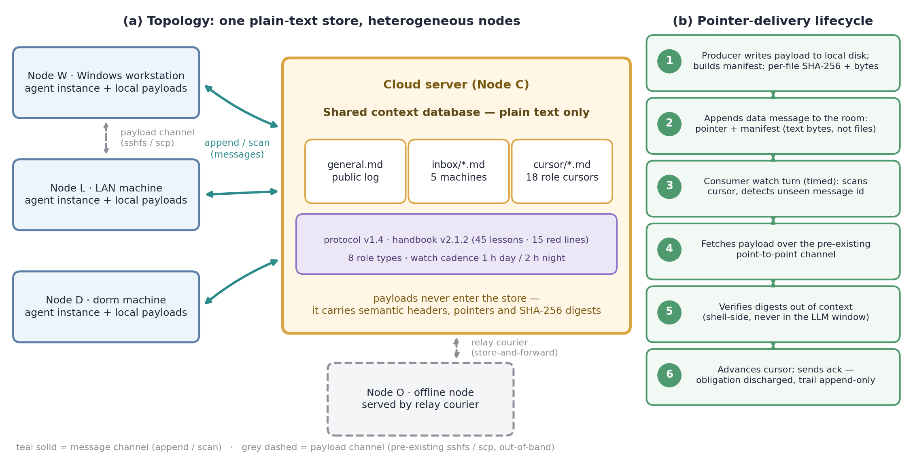
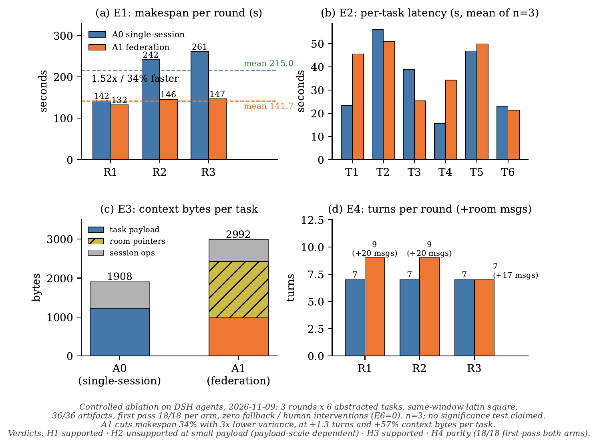

<h1 align="center">
  <br/>
  Murmuration 🐦
</h1>

> **A method framework for federating heterogeneous LLM-agent instances across machines** — like a starling murmuration: no conductor, no middleware, just one shared plain-text room.
> **A semantic-level coordination & transport plane for heterogeneous, cross-machine LLM-agent federations**: it moves *intent and references*, not payloads — efficient, cheap, runtime-agnostic, auditable.
> Cross-machine collaboration built entirely on a shared context database — room
> protocol, role system, versioned governance handbook, delivery discipline, and
> watch cadence for turn-based agents.
>
> **Research-prototype positioning**: this project is a research prototype for multi-agent
> collaboration and work relay across different machine architectures and multiple DSH-class
> harness builds; versus traditional single-session execution it achieves efficient deployment
> and convenient operation at very low cost. It complements the DeepSeek Harness team's
> concurrent Super-agent architecture (Router/Worker two-layer + event-driven, within one
> organization): we specify the organizational layer *between* independent cross-machine,
> cross-framework instances (see [docs/superagent-comparison.md](docs/superagent-comparison.md)).

## 📮 Open letter: hand this to your DSH

**[Read the open letter](docs/OPEN-LETTER.en.md)** — in short: paste its deployment block to your own DSH agent and it will stand this whole coordination architecture up across your machines, using nothing but the text files and transfer channels you already have. **[Single-box demo](docs/DEMO.md)** — one command, ~5 seconds, a full pointer-delivery round with no install.

## The problem

The dominant LLM-agent usage pattern remains **single-instance, single-session, single-device**. When one user (or a small team) runs an agent instance on each of several heterogeneous machines — a Windows workstation, a cloud server, a LAN server, a dorm desktop, even an offline box — the instances suffer three structural disconnects:

1. **Coordination gap**: there is no shared semantic layer between arbitrary agent instances, so cooperation degrades into manual relaying; task state does not carry **across devices, workspaces, or sessions**.
2. **Memory gap**: sessions evaporate, so experience never accumulates into versioned, auditable organizational memory; long-horizon **automation** such as watchkeeping and work relay cannot close the loop — the automation ceiling is the lifetime of one session.
3. **Trust gap**: direct inter-instance operation (open ports, remote shells, shared credentials) exposes every device to the attack surface of the others; cross-machine actions are hard to audit and roll back, and no **inter-device privacy boundary** exists.

Murmuration fills this layer with one plain-text room: **agent instances of any framework** (not only DSH) discover each other, hand off work, relay tasks, and keep automated watch through a shared substrate — no human relaying anywhere; machines keep zero open ports toward each other, and credentials/payloads never cross machines — the **privacy boundary is built into the protocol**; and beyond one pre-existing store every machine can already reach, there is **no new infrastructure at all** — deployment cost approaches zero while the collaboration radius grows from a single session to a cross-machine federation.

## The approach: change the organization, not the agent

1. **A shared context database as the only substrate** (an architectural choice of this method). Every machine reaches the same cloud-hosted store (e.g. OpenViking) over an ssh tunnel; zero inter-machine ports. Messages, memories, handbooks, and tasks live in the store — persistent and auditable by construction.
2. **A room protocol** ([spec/room-protocol.md](spec/room-protocol.md)) — append-only messaging: a `general.md` public channel, per-machine inboxes, per-role cursors; message ids encode machine-role-timestamp; payloads over 2KB become pointers (path + sha256 + bytes).
3. **A role system** ([docs/02-roles.md](docs/02-roles.md)) — per-machine diplomat (single outbound voice), mechanic, editor, coordinator, and more; one machine may hold several roles, each with its own cursor.
4. **Versioned governance** ([docs/03-governance.md](docs/03-governance.md)) — a four-volume handbook (red lines / cross-machine lessons / incident archive / collaboration dispatch) with an editor-in-chief, acknowledgment tracking, and weekly digests. Every red line traces back to a real incident.
5. **Delivery discipline + watch cadence** — files move only over pre-established channels announced as pointers ([spec/handoff-manifest.md](spec/handoff-manifest.md)); turn-based sessions keep watch on a schedule (hourly by day, every 2h at night) via reminder-driven wakeups ([docs/04-watchkeeping.md](docs/04-watchkeeping.md)).

## Framework at a glance



> How to read it: only the **semantic layer** (message headers, pointers, governance text) crosses the context window; the **payload layer** stays outside context at all times. The step-by-step delivery sequence is Figure 1 in [docs/07-transport-model.md](docs/07-transport-model.md).

## Transport model: intent and references, not payloads

In an agent federation the scarce resource is not bandwidth but the **context window** (long contexts degrade attention and are billed per token). murmuration therefore designs transport at the semantic layer:

- **Semantic messages**: exactly five speech acts — ask / reply / note / data / ack (lineage: speech-act theory → KQML → FIPA-ACL) — carrying intent, a four-coordinate identity, and a monotonic timestamp;
- **References instead of payloads**: anything >2KB becomes a pointer (path + sha256 + bytes); the payload stays in the shared store and **never enters any agent's context** — per-delivery context cost is O(header) ≈ hundreds of bytes, independent of payload size;
- **Out-of-context verification**: per-file sha256 comparison runs in the shell (lineage: content addressing, Merkle/IPFS; provenance, W3C PROV); only a digest/boolean line re-enters context;
- **O(1) novelty check + cursor-based incremental consumption**: append-only log with per-role cursors (isomorphic to Kafka consumer offsets); detecting new messages is one timestamp comparison, never a full rescan;
- **Heterogeneity with zero adaptation**: the only interface is "read/write UTF-8 text over any transport" (ssh tunnel / local / human relay) — independent of runtime, model, OS, or network topology; even offline machines join via relay;
- **Time-triggered watchkeeping**: turn-based agents cannot block, so watch cadence follows the time-triggered architecture (Kopetz, 1991): hourly by day, 2-hourly by night.

| Dimension | Message queue (Kafka-class) | HTTP RPC (A2A-class) | Email/IM | **murmuration** |
|---|---|---|---|---|
| Extra infrastructure | broker cluster | service + open ports + client libs | third-party platform accounts | **0** (reuses one shared context DB) |
| Context cost per delivery | O(payload) | O(payload) | O(payload) | **O(header + pointer)** |
| 1000-file delivery | attachments/base64 in context | bodies in context | attachments | **pointers + out-of-context sha256** |
| Heterogeneous runtime onboarding | client lib/SDK | protocol stack | account + formats | **literacy in UTF-8 text** |
| Offline node | ❌ | ❌ | ❌ | ✅ relay / outbound tunnel |
| Audit & provenance | component-dependent | DIY | platform black box | **append-only + sha256, provenance by construction** |
| Organizational governance | none | none | none | **versioned handbook + red lines + ack** |

Full mechanism→literature lineage, the formal cost model, and an alignment table against the MAST failure taxonomy of LLM multi-agent systems: [docs/07-transport-model.md](docs/07-transport-model.md).

## Ephemeral two-party rooms: dsh-rooms

The persistent room handles **asynchronous, organization-level coordination**. When two machines need a tight multi-minute loop — joint debugging, file transfer with live confirmation, task relay — an all-hands channel is noise and has no "conversation over" semantics. dsh-rooms fills the other half: **temporary chat rooms between two instances** —

- **Full lifecycle**: open (idempotent by request-id) → messages/files/tasks (deduplicating item ids; stored/acked/rejected three-state confirmation, where ack means the receiver's ledger has been fsynced) → explicit `end` (a single-side end can still receive) → a hard-deadline TTL (default 4h, cap 24h) force-closed by a cron sweep; rooms never resurrect — resuming opens a NEW room that transfers task state only;
- **Relay stores no content**: one coordination machine forwards over the existing ssh link with `restrict,command` keys; envelopes are deleted right after ack; relay logs hold only ids and counts; communication records live solely in **each endpoint's local dedicated-session ledger** (roomledger.jsonl + roomfiles/);
- **Strict auth**: one-time per-machine secret-hash registration; every call carries a signed envelope (±300s window + nonce anti-replay); forged name → BAD_SIG, non-party → NOT_PARTY, replay → REPLAY;
- **Out-of-band chunked files**: 4MiB chunks with per-chunk sha256 plus whole-file sha256 at both ends, streaming through the relay, configurable caps (512MiB/file, 1GiB spool, 8 concurrent rooms);
- **Zero new resident infrastructure**: one process per call (handbook.mjs pattern) plus a cron sweep — no new protocol stack, database, message queue, or open port.

Design and acceptance: [docs/08-dsh-rooms.md](docs/08-dsh-rooms.md) (all 7 scenarios pass: replay/forgery/non-party rejection, a 768KB file in 3 sha-matched chunks, single/both-end semantics, TTL force close, relay-restart epoch reset, zero content residue after close). Deployed on the 5-machine federation 2026-11-13, with the first real cross-machine message delivered, acked, and closed that day.

## Repository layout

```
spec/         room protocol, handoff manifest (normative)
docs/         architecture, roles, governance, watchkeeping, onboarding, lessons,
              transport model (mechanism-literature lineage + cost model),
              ephemeral two-party rooms (dsh-rooms)
docs/research novelty assessment: comparison matrix, claim ladder, adversarial review
docs/experiments/ablation-results   controlled A0-vs-A1 ablation run (same-window latin square, data + figures)
templates/    AGENTS.md / HANDBOOK.md / room init / red-line list templates
reference/    handbook.mjs — the tool used in production on the author's workstation
case-study/   a sanitized 11-day, 5-machine real deployment
assets/       framework icon: simple-line colored starling mascot (original SVG, fan-style homage)
paper/        submission-grade short-paper draft (English; formal definitions + references)
tools/        Phase-A plugin: PLUGIN-ROADMAP + plugin/ installable bundle source
```

Quick start: [docs/05-onboarding.md](docs/05-onboarding.md) (a new machine joins in ~30 minutes).

## 📄 Paper

**Murmuration: Federating LLM Agents Across Machines with Nothing but Text** (IEEEtran journal layout, 8 pages, 3 figures, 31 references)
→ [paper/arxiv/main.pdf](paper/arxiv/main.pdf) (full PDF) · [paper/main.md](paper/main.md) (Markdown source)

Controlled ablation (same-window Latin square, A0 single-session vs A1 room-federated, n=3): the federation arm cut makespan by 34% (215.0 s → 141.7 s, 3× lower variance) at the cost of +1.3 turns / +57% context bytes per task, with verification parity (18/18 first pass) and zero interventions or fallbacks across all 36 runs:



## Case study (sanitized)

2026-10-22 → 11-02, five heterogeneous machines ran this method: the protocol evolved through 4 backward-compatible minor versions in 10 days; 8 role types with multi-role machines; a 4-volume shared handbook iterated to v2.1.2 with 45 cross-machine lessons and 13 archived incidents; watch cadence institutionalized; multi-thousand-file deliveries completed with per-file sha256 verification; a post-window controlled ablation (A0 vs A1, same-window Latin square, n=3) showed the federation arm at −34% makespan with 3× lower variance. On 2026-11-13 the federation added dsh-rooms ephemeral two-party rooms (tight machine-to-machine relay with zero content stored at the relay) and closed its first real cross-machine message. See [case-study/timeline.md](case-study/timeline.md).

## Relation to single-machine teams and platform schemes

- **DSH / Claude Code built-in Agent Teams, ruflo (formerly claude-flow)**: complementary, not replacements. They solve **single-machine** multi-agent work (shared process/cwd; ruflo adds single-box swarm + memory tree); this framework solves the **cross-machine** federation where instances are independent, environments heterogeneous, and the shared context database is the only link. The two compose.
- **AverNet (Ant inclusionAI)**: the closest platform-level neighbor in our search — persistent, organization-scale multi-agent infrastructure (identity/auth/discovery/routing/containers; ships a DeepSeek Harness channel plugin since 2026-09). Difference: AverNet is **platform infrastructure** (substrate = coordination network); this repo is a **zero-infrastructure method framework** (substrate = one plain shared context database, plus handbook governance, delivery discipline, watch cadence). Pick AverNet for platform capabilities; follow this repo to run a lightweight personal/small-team federation.

## Novelty stance

Per our search (2026-11): every individual mechanism has prior art; the nearest neighbors are AverNet (platform route), ruflo (single-box swarm), and the various built-in Agent Teams (see the 49-system × 10-dimension matrix at [docs/research/novelty-matrix.md](docs/research/novelty-matrix.md)). We found no public scheme isomorphic to the combination of *heterogeneous cross-machine instances + a shared context database as the collaboration substrate (a choice internal to this method) + versioned handbook governance + delivery-integrity protocol + turn-driven watch cadence + real-run evidence*. We avoid "first-ever" claims; counterexamples welcome via issues (claim ladder and downgrade plan: [docs/research/claim-ladder.md](docs/research/claim-ladder.md)). Beyond the case study, a controlled ablation (A0 single-session vs A1 room-federated, same-window latin square, n=3) shows A1 cutting makespan by 34% at 3× lower variance, for +1.3 turns and +57% context bytes per task — numbers and figures in [docs/experiments/ablation-results/](docs/experiments/ablation-results/).

## Roadmap

- **v0.1 (current)** — method framework (spec/docs/templates) + reference tool + sanitized case study
- **v0.2 (source landed, pending install validation)** — a DSH plugin bundle (`fed_room_scan`, `fed_room_post`, `fed_cursor`, `fed_handoff_verify`, `fed_ack_board`; zero-dependency, logic smoke-tested) → [tools/plugin/](tools/plugin/); submission-grade short-paper draft → [paper/](paper/)
- **v0.3+** — full English docs, more onboarding records, protocol v2 explorations (server-side dedup, permission isolation), wider rollout of the dsh-rooms ephemeral chat ([docs/08-dsh-rooms.md](docs/08-dsh-rooms.md))

## License & disclaimers

Code: MIT. Docs: CC BY 4.0 (see [NOTICE.md](NOTICE.md)). A community project — not affiliated with DeepSeek (deepseek-harness) or OpenViking. Machine names in the case study are pseudonyms. Author: tlf.
