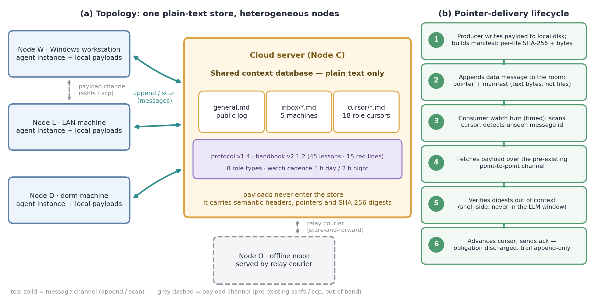

<h1 align="center">
  <br/>
  Murmuration 🐦
</h1>

> **跨机异构LLM-agent联邦协作方法框架** —— 如椋鸟群舞（murmuration）：无中心指挥、无中间件，一群独立agent靠一间纯文本房间协同。
> **面向跨机异构多智能体的语义级协调/传输平面**：传*意图与引用*，不传载荷 —— 高效、低成本、异构、可审计。
> A semantic-level coordination & transport plane for heterogeneous, cross-machine LLM-agent federations: it moves *intent and references*, not payloads.
> Federated collaboration for multiple DeepSeek Harness (DSH) agent instances —
> built entirely on a shared context database, with a room protocol, role system,
> versioned governance handbook, delivery discipline, and watch cadence.
>
> **研究原型定位**：本项目是一个研究原型，旨在不同架构和多DSH框架下多智能体之间的互相协作或工作接力；相比传统的单会话执行，我们只用了极低的成本就完成了高效的部署和便捷的运行。与DeepSeek Harness团队同期提出的Super-agent架构（单层组织内Router/Worker双层+事件驱动）互补：我们解决的是跨机、跨框架实例之间的组织层协作（详见 [docs/superagent-comparison.md](docs/superagent-comparison.md)）。

**English abstract** — Each machine runs its own AI agent instance, and none of them can (or should) open ports to each other. murmuration organizes such instances into a persistent, long-running team using only a shared context database (e.g. [OpenViking](https://docs.openviking.ai/)) as the collaboration substrate: an append-only "room" for messaging (public channel + per-machine inbox + per-role cursors), a role system with per-machine diplomats (一机多岗), a versioned operations handbook whose red lines are evolved from real incidents, a delivery protocol with sha256 integrity pointers, and a schedule-driven watch cadence designed for turn-based agents. This repository publishes the method as reusable specs, templates, a reference tool, and a sanitized 11-day / 5-machine case study. As of our search (2026-11), every individual mechanism has prior art; we did not find a public scheme isomorphic to this particular combination (see `docs/research/`).

📜 **给用户的公开信**：把 [docs/OPEN-LETTER.md](docs/OPEN-LETTER.md) 里的那段部署指令整段交给你的DSH，它就能高效地把你的多台设备部署上这一套管理架构。想做单机体验？`node tools/demo/demo.mjs` 五分钟看全程（[DEMO.md](docs/DEMO.md)）。

## 解决什么问题

主流LLM agent使用范式仍以**单实例、单会话、单设备**为中心。当一位用户或小团队在多台异构设备上各自运行agent实例——Windows工作站、云端服务器、局域网服务器、宿舍终端、乃至无外网隔离机——实例之间存在三重结构性断裂：

1. **协作断裂**：任意两个agent实例之间缺少统一的协调语义层，彼此合作依赖人工转达与口头同步；任务状态无法**跨设备、跨工作区、跨会话**自然延续。
2. **记忆断裂**：会话即焚，经验与教训无法沉淀为版本化、可审计的组织记忆；值守与接力等**长时程自动化**因此无法闭环——自动化的上限被锁死在单次会话的寿命之内。
3. **信任断裂**：实例间直接互操作（开放端口、远程shell、共享凭据）将每台设备暴露于对方的攻击面，跨机操作难审计、难回滚，**设备间隐私边界**无从建立。

Murmuration以一间纯文本房间补齐这一层：**任意框架的agent实例**（不限于DSH）经共享底座完成互相发现、工作交接、任务接力与自动值守，协调全程无需人工转达；设备彼此零端口开放，凭据与载荷永不跨机——**隐私边界内生于协议**；除一处所有机器均可访问的既有存储外**零新增基础设施**，部署成本趋近于零，而协作半径从单会话扩展为跨机联邦。

## 核心思路：不改agent，改组织方式

用五件事把独立实例组成"联邦"：

1. **共享上下文数据库作为唯一协作底座**（本方案的架构选择）—— 所有机器通过ssh隧道访问同一个云端共享库（OpenViking），彼此零端口开放。消息、记忆、手册、任务都在库里，天然持久化与可审计。
2. **房间协议**（[spec/room-protocol.md](spec/room-protocol.md)）—— append-only消息：`general.md` 公共频道 + `inbox/<机器>.md` 收件箱 + `cursor/<机器>-<岗位>.md` 游标；消息id带机器-岗位-时间戳；大附件以"路径+sha256+字节数"指针替代。
3. **岗位体系**（[docs/02-roles.md](docs/02-roles.md)）—— 外交官（统一对外发声）、机械师（运维）、主编（手册治理）、协调员等；一机可多岗，游标分账。
4. **版本化治理手册**（[docs/03-governance.md](docs/03-governance.md)）—— 四卷手册（总则红线/跨机经验/事故档案/协作分发），主编制度、ack追踪、每周汇总；红线条目全部由真实事故反推而来。
5. **交付协议与值守节律**（[spec/handoff-manifest.md](spec/handoff-manifest.md)、[docs/04-watchkeeping.md](docs/04-watchkeeping.md)）—— 文件交付只走既有通道、通知只给指针；turn-driven会话靠schedule定时提醒按节律"值班"。

## 框架总览图



>读图：穿越上下文窗口的只有**语义层**（消息头部、指针、治理文本）；**载荷层**恒留在上下文之外。交付的逐步时序见 [docs/07-transport-model.md](docs/07-transport-model.md) 图1。

## 传输模型：传意图与引用，不传载荷

agent联邦的稀缺资源不是带宽，而是**上下文窗口**（长上下文有注意力退化与按token计费的双重代价）。因此本框架把"传输"设计在语义层：

- **语义消息**：仅五种言语行为ask / reply / note / data / ack（谱系：言语行为理论 → KQML → FIPA-ACL），携带意图、身份四坐标与单调时间戳；
- **引用代替载荷**：>2KB一律化为"路径 + sha256 + 字节数"指针；载荷留在共享库、**零入上下文** —— 单次交付的上下文成本O(头部)≈百字节，与载荷大小无关；
- **上下文外校验**：sha256逐文件比对在shell完成（谱系：内容寻址Merkle/IPFS、溯源W3C PROV），回流上下文的仅一行digest/布尔；
- **O(1)判新 + 游标增量消费**：append-only日志 + 每岗位游标（与Kafka consumer offset同构），判新只比一次时间戳，不全量重扫；
- **异构零适配**：接入接口 = "经任意传输读写UTF-8文本"（ssh隧道 / 本地 / 人工中继），与运行时、模型、OS、网络形态无关；无外网机经中继入联邦；
- **时间触发值守**：turn-based agent不能阻塞等待，按time-triggered架构（Kopetz 1991）定值守节律（白天1h / 夜间2h）。

| 维度 | 消息队列（Kafka类） | HTTP RPC（A2A类） | 邮件/IM | **murmuration** |
|---|---|---|---|---|
| 额外基础设施 | broker集群 | 服务+开端口+客户端库 | 第三方平台账号 | **0**（复用共享上下文库） |
| 单次交付上下文成本 | O(载荷) | O(载荷) | O(载荷) | **O(头部+指针)** |
| 千文件级交付 | 附件/base64进上下文 | 消息体进上下文 | 附件 | **指针 + 上下文外sha256** |
| 异构运行时接入 | 客户端库/SDK | 协议栈 | 账号+格式 | **会读写文本即可** |
| 无外网节点 | ❌ | ❌ | ❌ | ✅ 中继/出站隧道 |
| 审计与溯源 | 依赖组件 | 自建 | 平台黑箱 | **append-only + sha256天然溯源** |
| 组织治理 | 无 | 无 | 无 | **版本化手册+红线+ack** |

机制—学术谱系—成本模型的完整推导见 [docs/07-transport-model.md](docs/07-transport-model.md)（含与LLM-MAS失败taxonomy MAST的对位）。

## 仓库结构

```
murmuration/
├── README.md / README.en.md     你在这里
├── spec/                        房间协议、交付协议（机器可依循的规范）
├── docs/                        架构 / 岗位 / 治理 / 值守 / 接入 / 教训 / 传输模型(学术谱系+成本模型)
│   ├── research/                新颖性评估：对标矩阵、主张阶梯、反方审查、检索日志
│   └── experiments/ablation-results/  A0 vs A1受控消融实测（同窗拉丁方，数据+图件）
├── templates/                   AGENTS.md / HANDBOOK.md / 房间初始化 / 红线清单模板
├── reference/                   handbook.mjs 参考工具（生产环境在用）
├── case-study/                  11 天 / 5 台机器的脱敏运行案例
├── assets/                      框架图标：简笔彩色椋鸟吉祥物（原创 SVG）
├── paper/                       投稿级短文草稿（英文，含形式化定义与参考文献）
└── tools/                       Phase A 插件：PLUGIN-ROADMAP + plugin/ 可安装 bundle 源码
```

## 快速开始（30分钟接入一台机器）

1. 装DSH并建工作区；装Node.js ≥18（跑参考工具）。
2. 连通共享上下文数据库（云端部署OpenViking，本机隧道接入）。
3. 抄 `templates/AGENTS.template.md` 到用户级AGENTS.md（注入"开工先查手册、收工写回"的规矩）。
4. 按 `templates/room-init.md` 建房（或加入已有房），发第一条自介消息（身份四坐标）。
5. 认领岗位、建游标、开始第一单任务。

完整清单见 [docs/05-onboarding.md](docs/05-onboarding.md)。

## 案例摘要（脱敏）

2026-10-22至11-02，5台异构机器（Windows工作站 / 云端服务器 / 局域网服务器 / 宿舍机 / 无外网机）按本方法组成联邦：协议10天演化4个小版本；8类岗位、一机多岗普遍；四卷共享手册迭代至v2.1.2，45条跨机经验、13起归档事故；值守从"有事才看"制度化为白天每小时/夜间每2小时；期间完成多笔上千文件级交付（逐文件sha256校验）。详见 [case-study/timeline.md](case-study/timeline.md)。

## 与单机团队机制和平台方案的关系

- **DSH内置Agent Teams / Claude Code Agent Teams / ruflo（原claude-flow）**：互补而非替代。这些解决**单机**多agent协作（共享进程、cwd与任务板；ruflo主打单机蜂群+记忆树）；本框架解决**跨机**联邦——独立实例、异构环境、跨网络，以共享上下文数据库为唯一纽带。两者可以叠用（单机内部用Teams，机间用联邦）。
- **AverNet（蚂蚁inclusionAI）**：检索范围内定位最近的平台级方案——组织规模的持久多agent基础设施（身份/鉴权/发现/路由/容器，2026-09起亦提供DeepSeek Harness channel插件）。差异：AverNet是**平台基础设施**（底座为协调网络），本仓库是**零基础设施的方法框架**（底座为一个普通共享上下文数据库，附手册治理、交付纪律与值守节律）。需要平台能力选AverNet；想要轻量个人/小团队联邦可直接照本仓库方法落地。

## 新颖性口径

据检索（2026-11）：多智能体协作框架、邮箱/黑板机制、通信协议、治理工具包等**单点机制均有先例**，最近邻为AverNet（平台路线）、ruflo（单机蜂群）、各家单机Agent Teams（对标矩阵见 [docs/research/novelty-matrix.md](docs/research/novelty-matrix.md)，49系统 × 10维）；"跨机异构实例 + 以共享上下文数据库为协作底座（方案内架构）+ 版本化治理手册 + 交付完整性协议 + turn-driven值守节律 + 真实运行证据"这一**组合**未发现完整同构的公开方案。我们不使用"首创/第一"表述；如你发现反例，欢迎提issue（主张阶梯与降档预案见 [docs/research/claim-ladder.md](docs/research/claim-ladder.md)）。

## 路线图

- **v0.1（当前）**：方法框架（spec/docs/templates）+ 参考工具 + 脱敏案例
- **v0.2（源码已落地，待安装验证）**：DSH插件bundle（fed_room_scan / fed_room_post / fed_cursor / fed_handoff_verify / fed_ack_board，零依赖+逻辑冒烟测试通过）→ [tools/plugin/](tools/plugin/)；投稿级短文草稿 → [paper/](paper/)
- **v0.3+**：英文全量文档、更多环境的接入记录、协议v2（服务端去重与权限隔离探索）

## 许可与声明

- 代码（含 `reference/`）：MIT；文档：CC BY 4.0（见 [NOTICE.md](NOTICE.md)）。
- 本项目为社区项目，与DeepSeek（deepseek-harness）、OpenViking项目无隶属关系。
- 案例中机器均为化名，已按脱敏规则处理；作者：tlf。
