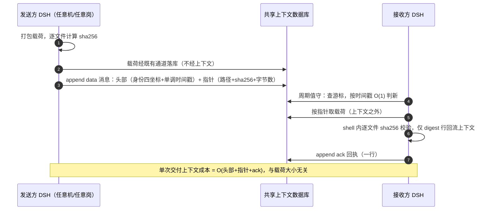

# 07 · 语义级协作传输模型：机制—学术谱系—成本模型

> **Semantic-level Coordination & Transport Model**
> murmuration 把"多 agent 之间的传输"定义在**语义层**：穿越 agent 上下文窗口的只有*意图（speech act）与引用（content-addressed pointer）*，载荷本体留在共享上下文数据库内、零入上下文。本文给出每个机制的学术谱系、形式化成本模型，以及与已知 LLM 多智能体失败 taxonomy 的对位。

## 1 问题定义：上下文窗口是信道，不是带宽

传统多智能体通信研究默认信道稀缺物是**带宽**；LLM agent 联邦中，稀缺物是**上下文窗口**：

- 长上下文存在注意力退化（"lost in the middle"，Liu et al., 2023, arXiv:2307.03172, TACL 2024）；
- 上下文即成本：每次把消息体/附件读入 prompt 都按 token 计费，且中继每一跳重复付费（成本感知 LLM 使用之谱系：FrugalGPT, Chen et al., 2023, arXiv:2305.05176）；
- agent 记忆与共享知识的组织本身是开放问题（memory 综述：Zhang et al., 2024, arXiv:2404.13501；LLM-MAS 综述：Guo et al., 2024, arXiv:2402.01680, IJCAI 2024）。

**定义 1（语义级传输）**：一次交付 d = (a, p, r)，a 为言语行为头部（performative + 身份四坐标 + 单调时间戳），p 为内容寻址指针（路径 + sha256 + 字节数），r 为可选内联正文（|r| ≤ 2KB 阈值）。载荷本体 P 不经信道。

**图 1 · 一次交付的时序（sequence）**

## 2 机制—学术谱系对照

| # | murmuration 机制 | 学术谱系 | 关键文献 |
|---|---|---|---|
| 1 | 五种消息类型 ask/reply/note/data/ack | 言语行为理论 → agent 通信语言（ACL）最小 performative 集 | Searle 1969; KQML, Finin et al., CIKM 1994; FIPA-ACL Spec., 2002 |
| 2 | 房间 = append-only 共享消息区 | 元组空间 / 黑板 / 发布订阅 | Linda, Gelernter, TOPLAS 1985; Blackboard, Nii, AI Magazine 1986; Pub/Sub, Eugster et al., ACM CS 2003 |
| 3 | 游标 cursor = 每消费者增量偏移 | 日志 + consumer offset（分区主题之 per-consumer 位点） | Kafka, Kreps et al., NetDB 2011 |
| 4 | >2KB 载荷以"路径+sha256+字节数"指针替代 | 内容寻址 / Merkle 摘要 /  provenance | Merkle 1980; IPFS, Benet, arXiv:1407.3561; W3C PROV-Overview, 2013 |
| 5 | 传意图与引用、不传比特载荷 | 语义通信（Shannon 三问题之 B/C 层）与目标导向语义通信 | Shannon & Weaver 1949; goal-oriented semantic communication survey, arXiv:2512.12758 |
| 6 | 异构运行时零适配接入（接口=读写 UTF-8 文本） | 环境中介协调（stigmergy）：以共享环境而非直接消息协调 | Theraulaz & Bonabeau, Artificial Life 1999; Malone & Crowston, ACM CS 1994（协调理论） |
| 7 | 版本化手册 + 红线（事故反推）+ 主编制 | 规范多智能体系统 / 电子制度 / 组织模型 | Esteva et al. 2001（电子制度形式化）; MOISE+, Hübner et al. 2002; OperA, Dignum et al. 2004; Boella et al. 2006（normative MAS） |
| 8 | ack 追踪与 48h 催办 | 社会承诺（commitment）作为规范概念 | Singh, Artificial Intelligence and Law 1999 |
| 9 | turn-driven 值守节律（白天 1h / 夜间 2h 定时轮询） | 时间触发 vs 事件触发架构：turn-based agent 无法阻塞等待，故选 time-triggered | Kopetz, Dagstuhl 1991（event-triggered vs time-triggered） |
| 10 | 判新 = mid 尾部时间戳 O(1) 比较 | 单调逻辑时钟之工程化简化（避免整串字典序陷阱） | Lamport, CACM 1978（谱系注记；本方案取后缀时间戳之实用变体） |

## 3 成本模型

记 P=载荷字节数，H=头部+指针字节数（实测量级 10^2），T(·)=token 化成本，N=房内消息总数，Δ=自上次游标以来的新消息数。

| 方案 | 单次交付的上下文成本 | 判新成本 | 千文件级交付 | 中继 k 跳 |
|---|---|---|---|---|
| 消息体进上下文（MQ/HTTP/邮件/IM） | T(P) | O(N) 全量重扫或依赖组件 | 附件/base64 进上下文，T(ΣP) | 每跳重付 T(P) |
| **murmuration** | **T(H) = O(1)，与 P 无关** | **O(1)**（时间戳后缀比较） | **指针行 + 上下文外 sha256 布尔**，T(H) | **0 重复付费**（载荷不动，指针幂等） |

- 校验在上下文外完成（shell 内 sha256 逐文件比对），回流上下文的仅一行 digest/布尔 —— 验证成本从"读入再比对"降为"执行再读结论"。
- 指针幂等：同一 sha256 的指针可被任意消费者重复解析而无需重传，交付对消费者数量不敏感（对比：每消费者单播重传）。
- 案例佐证（脱敏）：11 天 / 5 机运行中多笔上千文件级交付均按"指针 + 逐文件 sha256"完成，见 [../case-study/metrics.md](../case-study/metrics.md)。

## 4 与 LLM-MAS 失败 taxonomy 的对位

MAST（Cemri et al., 2025, arXiv:2503.13657, NeurIPS 2025 D&B）将多智能体系统失败归类为规格违背、智能体间错位、验证缺失、任务验证不足等族。本框架的机制对位：

| MAST 失败族（节选） | 对位机制 |
|---|---|
| Specification violation | 版本化手册红线 + AGENTS.md 注入（开工先查、收工写回） |
| Inter-agent misalignment | 身份四坐标自介 + 外交官单一出口 + 游标分账 |
| Lack of verification | 交付协议强制 sha256 指针与上下文外校验 |
| Unreliable/ungoverned escalation | ack 追踪 + 48h 催办 + 事故归档驱动红线演化 |

（对位为设计意图声明，非实证评测；本仓库不宣称对 MAST 的量化改进。）

## 5 边界与非主张

- 本模型**不是**新的通信理论或新的 ACL：它是已验证原语（元组空间/日志/内容寻址/规范组织/时间触发）在"turn-based LLM agent + 零基础设施"约束下的**组合与工程化**，新颖性主张维持 L2 限定口径（见 [research/claim-ladder.md](research/claim-ladder.md)）。
- 语义层阈值（2KB）、值守节律（1h/2h）为案例实测参数，非普适常数；接入方应按自身 turn 成本重标定。
- 共享上下文数据库是唯一信任根：其可用性/权限模型即联邦的可用性/权限模型（协议 v2 探索服务端去重与权限隔离，见 README 路线图）。
