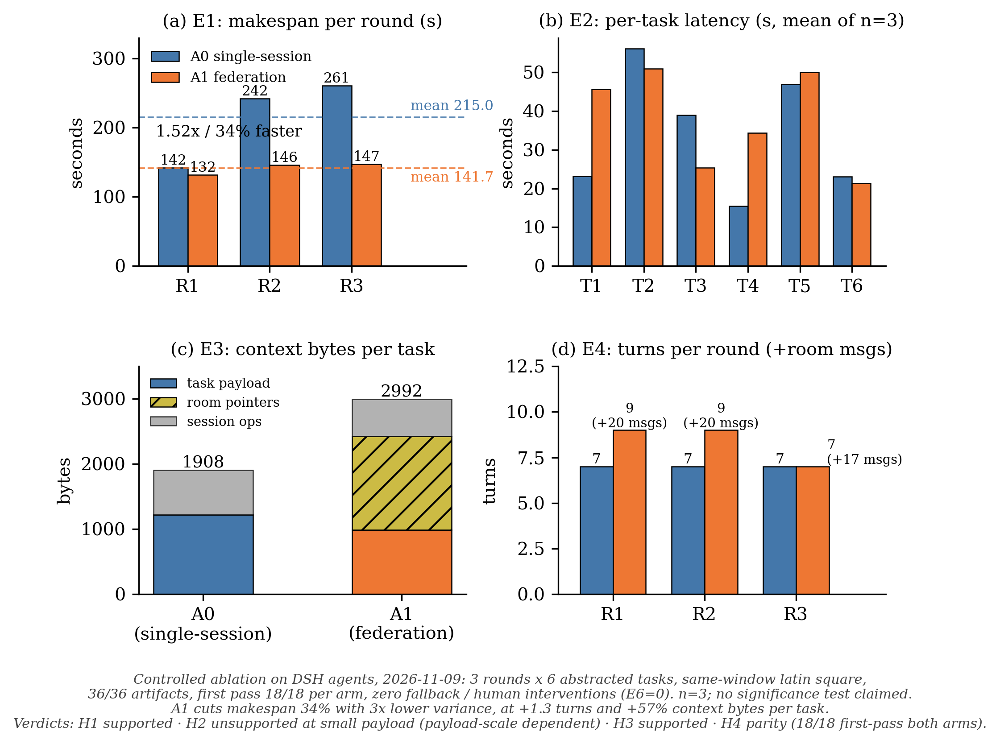

# Ablation results — A0 (single-session) vs A1 (federation via room protocol)

Controlled ablation executed 2026-11-09 13:26:49–13:47:15 (Asia/Shanghai), same-window
continuous, Latin-square interleaved (R1 A0→A1 / R2 A1→A0 / R3 A0→A1), 3 rounds × 6 abstracted
tasks. Orchestrated by the nuomi-room crew; no human interventions (E6=0), zero runner fallback.

## Headline numbers (task-level means, n=18 per arm = 6 tasks × 3 rounds)

| Metric | A0 single-session | A1 federation | Note |
|--------|------------------|---------------|------|
| E1 makespan / round | 215.0 s (142/242/261) | **141.7 s (132/146/147)** | A1 34% faster (1.52×), range 15 s vs 119 s |
| E2 per-task latency | 34.0 s | 37.9 s | A1 includes room-ack wait |
| E3 context bytes / task | 1908 B (payload 1219) | 2992 B (payload 986 + pointers 1439) | H2 unsupported at small payload |
| E4 turns / round | 7.0 | 8.3 | +57 room messages total |
| E5 first pass | 18/18 | 18/18 | zero retries both arms |
| E6 human interventions | 0 | 0 | |

## Hypothesis verdicts (numbers only; n=3, no significance test claimed)

- **H1 parallelism gain — supported.** A1 < A0 makespan in every round (132–147 vs 142–261 s); A1 also 3× lower variance.
- **H2 context economy — unsupported at this payload scale.** Per-task total reads A1 > A0 (2992 vs 1908 B); payload body is slightly lower under A1 (986 vs 1219 B) but room-protocol pointer reads (1439 B/task) exceed the saving. Payload size is the key moderator (largest seed here ≈ 2 KB).
- **H3 coordination overhead — supported.** +1.3 turns/round, 57 room messages, tool calls per task 7.9 vs 5.9.
- **H4 verification quality — parity.** first-pass 18/18 both arms, sha256 recheck all pass.

## Protocol deviations (cite when quoting numbers)

1. A1 is a minimal local federation (two independent headless DSH sessions on one machine), not cross-machine; the room is a local plain-text store with production-identical protocol fields, not the production OpenViking room.
2. E3 counts session-transcript tool_result bytes, classified: room/pointer reads → pointer; seed/results reads → payload; bash output → session ops; other → other. A1 aggregates two sessions attributed to tasks by time window.
3. E2 for A1 = data-message ts → ack ts (includes queueing, not pure execution); A0 = task turn start/end.
4. Full run record: [`实验记录.md`](./实验记录.md) · task-level data: [`summary.csv`](./summary.csv) · plan: [`../ablation-plan-v1.md`](../ablation-plan-v1.md)

## Provenance & integrity

- Executed by nuomi (`tools/run_ablation.py --rounds 3`, dsh 0.2.1-rc.2 headless, both arms same model/temperature, reasoningEffort=max).
- Delivery chain: nuomi machine → OpenViking resources (`experiments/murmuration-ablation/`) → mixian, sha256 verified at each hop. Numbers-only discipline: no task content is exposed in this directory.
- Figure: [`render_fig3.py`](./render_fig3.py) regenerates `fig3-ablation.pdf`/`.png` from `summary.csv` (matplotlib only).

## Files

| File | What |
|------|------|
| `summary.csv` | 36 task rows, E1–E6 + payload/pointer byte split |
| `实验记录.md` | round-level metrics, anomalies (none), deviations §4 |
| `fig3-ablation.pdf` / `.png` | 4-panel figure (E1/E2/E3/E4) |
| `render_fig3.py` | figure source (data-driven from summary.csv) |
